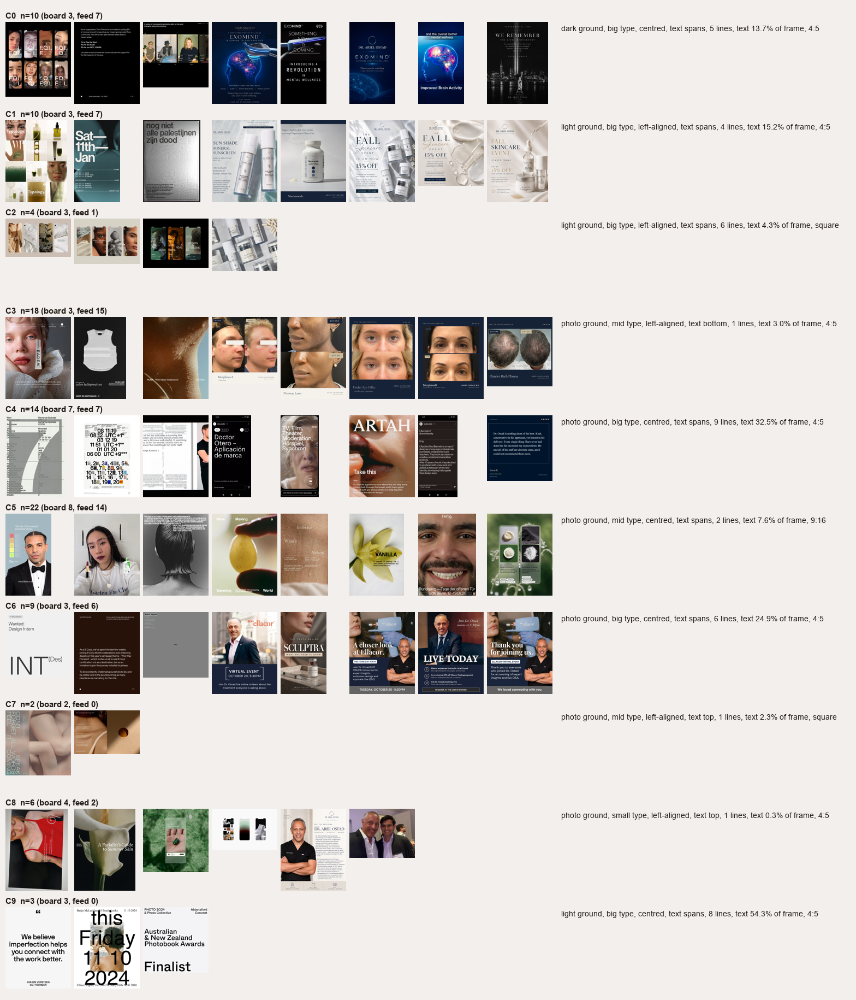

# Layouts

Generated by `scripts/layouts.py`. Features per image come from `metrics/pixels.json`. k-means picks k by silhouette over 8–10, with favourites weighted 3×.

k = 10. Silhouette: 8: 0.187, 9: 0.188, 10: 0.189. All three scores are under 0.2, so the clusters are weak: the board's layouts form a continuum, not distinct types (DECISIONS 41).

Which template a cluster maps to is a judgment call (DECISIONS 42). Each template cites board blocks from its own cluster; see `kit/templates/*/slots.json` → `board_blocks`.

| cluster | n (board/feed) | reads as | board members | templates |
|---|---|---|---|---|
| C0 | 10 (3/7) | dark ground, big type, centred, text spans, 5 lines, text 13.7% of frame, 4:5 | 7529470, 27454113, 24130326 | caption-card |
| C1 | 10 (3/7) | light ground, big type, left-aligned, text spans, 4 lines, text 15.2% of frame, 4:5 | 32335068, 33635746, 52020245 | list |
| C2 | 4 (3/1) | light ground, big type, left-aligned, text spans, 6 lines, text 4.3% of frame, square | 14664481, 16453124, 13828406 | story |
| C3 | 18 (3/15) | photo ground, mid type, left-aligned, text bottom, 1 lines, text 3.0% of frame, 4:5 | 34175362, 2527310, 47483045 | before-after |
| C4 | 14 (7/7) | photo ground, big type, centred, text spans, 9 lines, text 32.5% of frame, 4:5 | 36747221, 39832259, 50510620, 11460382, 13607089, 47483050, 13902728 | announcement |
| C5 | 22 (8/14) | photo ground, mid type, centred, text spans, 2 lines, text 7.6% of frame, 9:16 | 52313969, 21587531, 30880633, 22772082, 28246874, 26381730, 52302251, 41432513 | procedure-card |
| C6 | 9 (3/6) | photo ground, big type, centred, text spans, 6 lines, text 24.9% of frame, 4:5 | 27647159, 27454118, 52340827 | carousel-cover |
| C7 | 2 (2/0) | photo ground, mid type, left-aligned, text top, 1 lines, text 2.3% of frame, square | 2145281, 38944212 | carousel-body |
| C8 | 6 (4/2) | photo ground, small type, left-aligned, text top, 1 lines, text 0.3% of frame, 4:5 | 40898406, 47311638, 41911984, 15688099 | carousel-end |
| C9 | 3 (3/0) | light ground, big type, centred, text spans, 8 lines, text 54.3% of frame, 4:5 | 32197302, 31223791, 30248124 | single-statement, quote |

