# Visual devices on the board

`scripts/look_catalog.py`. 53 board images. images, favourites x3
(the same weight shapes.py uses). Keep rule: weighted count >= 4 and at least 2 distinct images (>= 3 kept 16, over the spec's 10-15 cap). brand-venv python -I.

**15 kept:** photo_treatment, hairline_rule, grain, meta_label, screen_frame, step_marks, leader_line, dark_card, glass_panel, pill_chip, photo_card, vertical_type, icon_outline, outline_box, dotted_path.

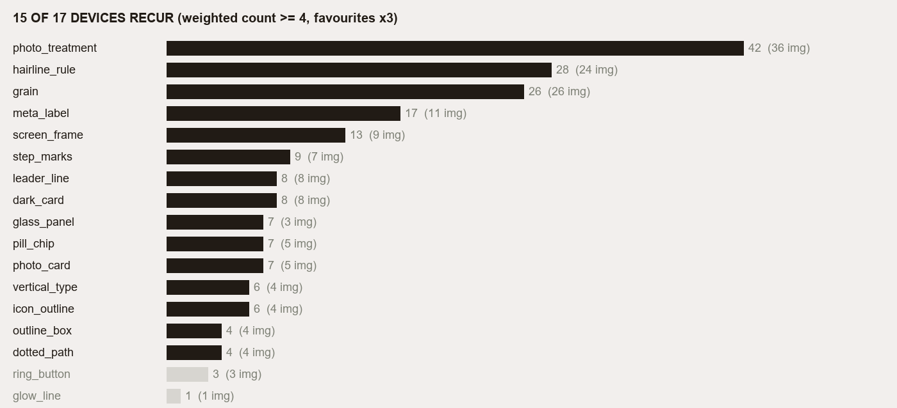

| Device | Images | Weighted | Kept | Tagged by | Blocks |
|---|---|---|---|---|---|
| photo_treatment | 36 | 42 | yes | measured | 12087163, 12400773, 13828406, 14664481, 15688099, 16453124, 16463981, 2145281, 21587531, 22772082, 23958815, 24130326 … |
| hairline_rule | 24 | 28 | yes | measured | 11460382, 12087163, 13607089, 13828406, 13902728, 14664481, 16453124, 16463981, 23958815, 24130326, 24946075, 28246874 … |
| grain | 26 | 26 | yes | measured | 11460382, 12087163, 13607089, 13828406, 13902728, 15688099, 16453124, 24130326, 24946075, 27454113, 27454118, 27647159 … |
| meta_label | 11 | 17 | yes | judgment (contact sheets + blocks.json) | 13828406, 14664481, 16463981, 2145281, 22772082, 23958815, 24130326, 28246874, 30248124, 34126462, 7529470 |
| screen_frame | 9 | 13 | yes | judgment (contact sheets + blocks.json) | 11460382, 12087163, 13607089, 13828406, 14664481, 15688099, 16453124, 34771058, 7529470 |
| step_marks | 7 | 9 | yes | judgment (contact sheets + blocks.json) | 11460382, 14664481, 16463981, 27454113, 27454118, 31815447, 34175362 |
| leader_line | 8 | 8 | yes | judgment (contact sheets + blocks.json) | 12400773, 16463981, 21587531, 23958815, 30940781, 33635746, 34126462, 52386109 |
| dark_card | 8 | 8 | yes | judgment (contact sheets + blocks.json) | 11460382, 12087163, 13902728, 24130326, 2527310, 27454113, 27454118, 47311638 |
| glass_panel | 3 | 7 | yes | judgment (contact sheets + blocks.json) | 2145281, 41432513, 41911984 |
| pill_chip | 5 | 7 | yes | judgment (contact sheets + blocks.json) | 11460382, 27647159, 41432513, 41911984, 52313969 |
| photo_card | 5 | 7 | yes | judgment (contact sheets + blocks.json) | 15688099, 24130326, 34771058, 41432513, 41911984 |
| vertical_type | 4 | 6 | yes | judgment (contact sheets + blocks.json) | 2145281, 30940781, 40898406, 50510620 |
| icon_outline | 4 | 6 | yes | judgment (contact sheets + blocks.json) | 11460382, 13607089, 14664481, 24130326 |
| outline_box | 4 | 4 | yes | judgment (contact sheets + blocks.json) | 21587531, 23958815, 30940781, 47161957 |
| dotted_path | 4 | 4 | yes | judgment (contact sheets + blocks.json) | 33635746, 34126462, 34175362, 47161957 |
| ring_button | 3 | 3 | no | judgment (contact sheets + blocks.json) | 13607089, 34175362, 38155009 |
| glow_line | 1 | 1 | no | judgment (contact sheets + blocks.json) | 38155009 |

## What each one is, with its crop

### photo_treatment

Photo treatment: desaturated, warm, low-contrast photography (measured by treatment.py).

Proof (source / rebuilt / kit): 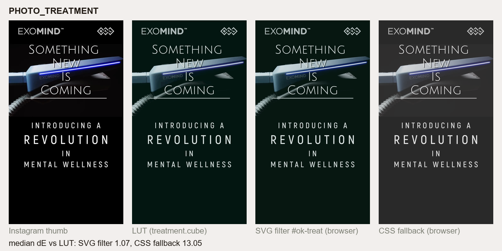

### hairline_rule

Hairline rule: a thin horizontal divider (measured by shapes.py).

Proof (source / rebuilt / kit): 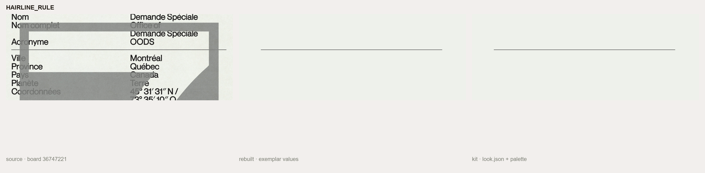

### grain

Grain: visible film noise in flat areas (measured by shapes.py).

Proof (source / rebuilt / kit): 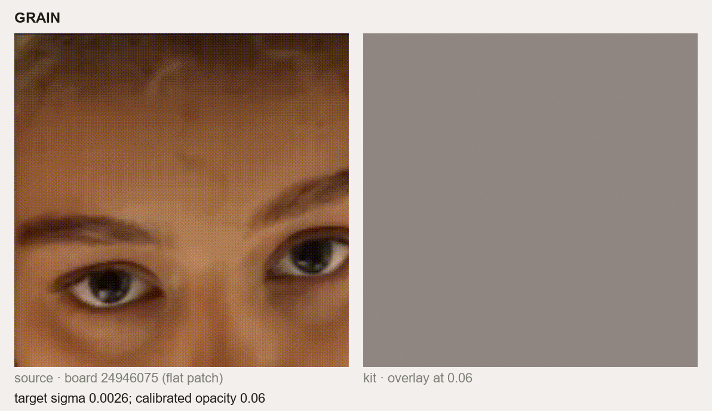

### meta_label

Meta label: small caps or mono data text in the corners ('/ Outside /', codes, dates).

Proof (source / rebuilt / kit): 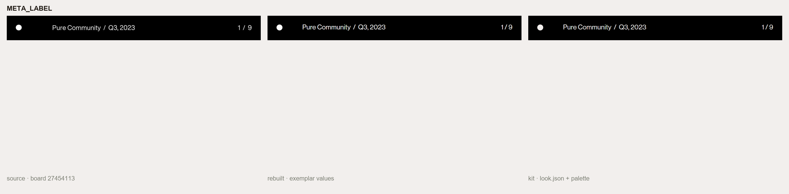

### screen_frame

Screen frame: a tall rounded rectangle (phone screen) holding a story.

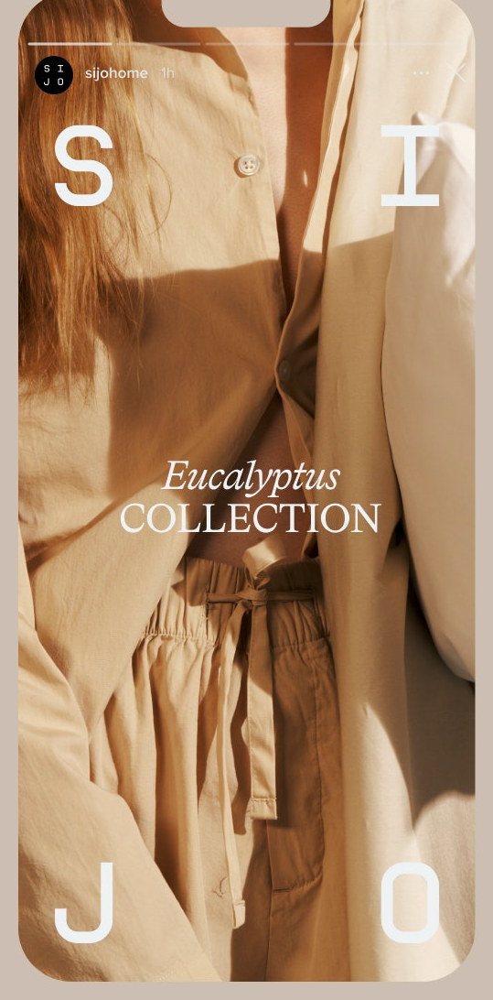
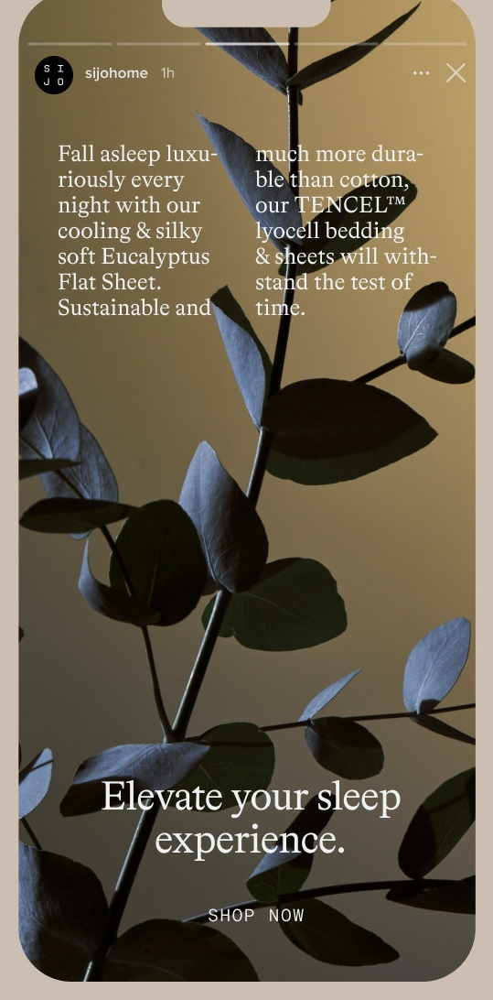
Proof (source / rebuilt / kit): 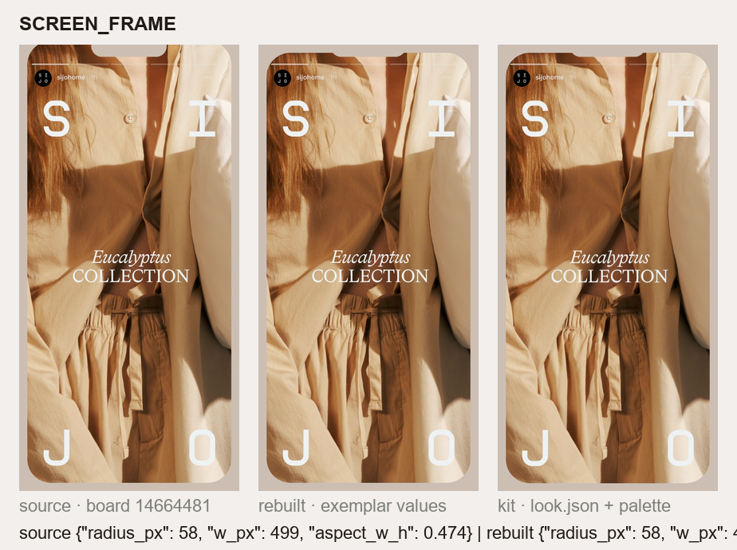

### step_marks

Step marks: numbered rings on a dotted line, story progress bars, page count '1 / 9'.

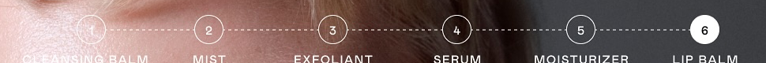
Proof (source / rebuilt / kit): 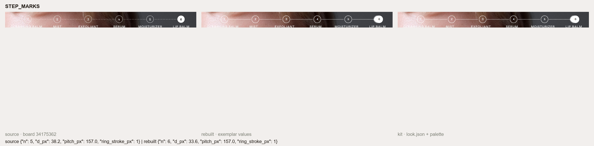

### leader_line

Leader line: a hairline from a point on the subject to a label, ending in a small dot.

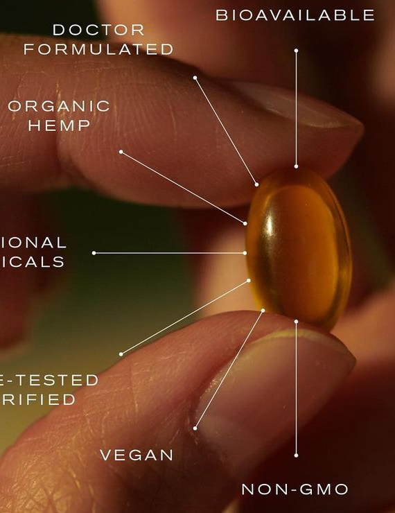
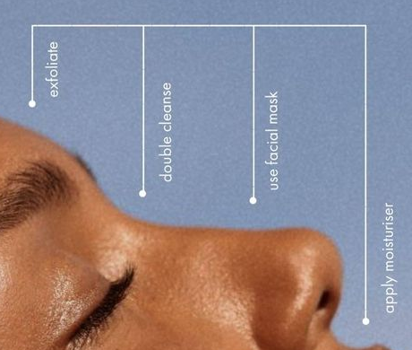
Proof (source / rebuilt / kit): 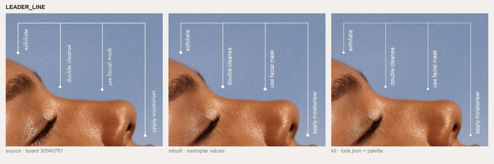

### dark_card

Dark card: black or deep brown slide with small light text.

Proof (source / rebuilt / kit): 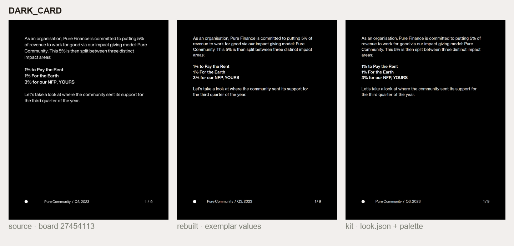

### glass_panel

Frosted glass: a translucent card or band over a photo, backdrop blurred, no rim light, no drop shadow.

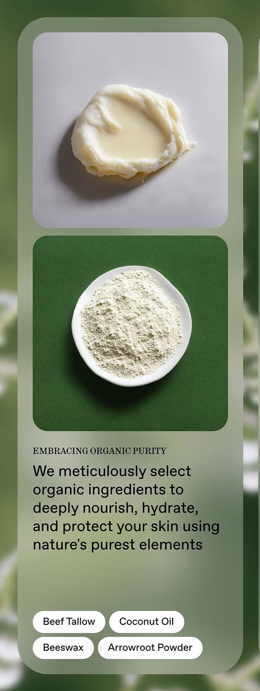
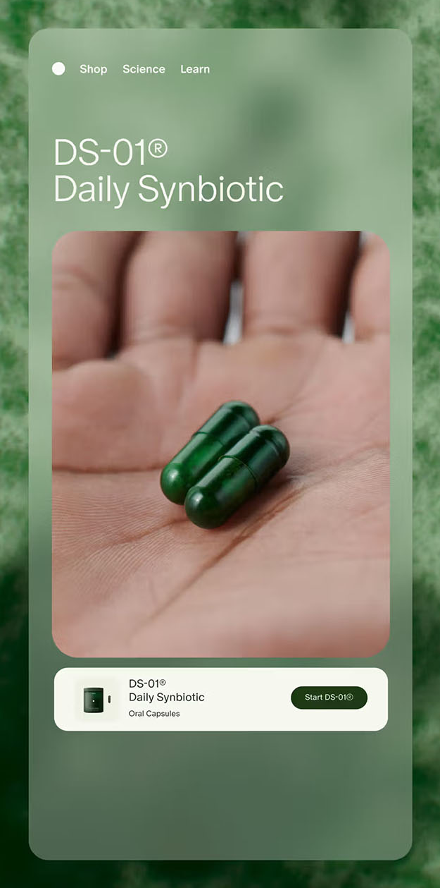
Proof (source / rebuilt / kit): 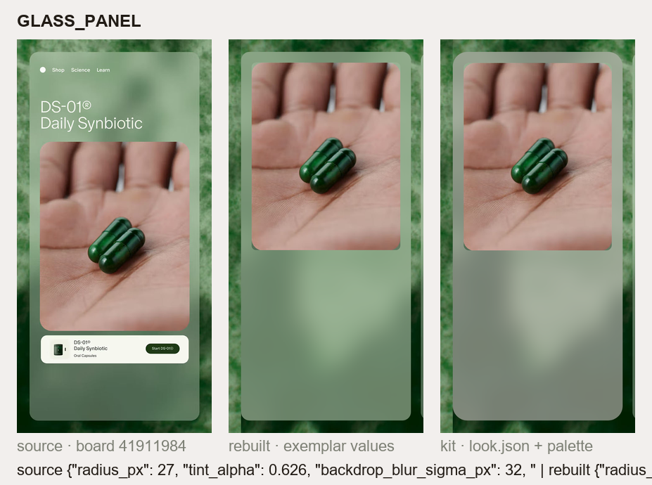
Proof (source / rebuilt / kit): 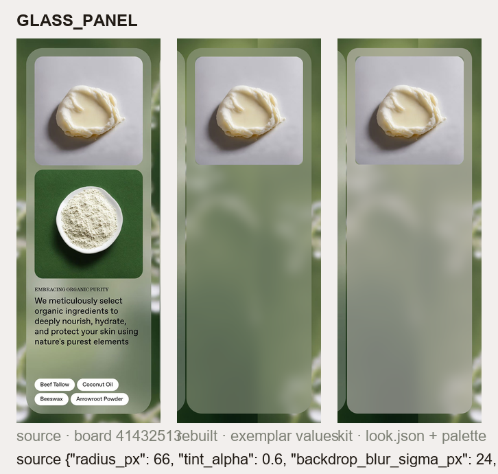

### pill_chip

Pill: a fully rounded label (radius = half the height), filled white or grey, or outlined on dark.

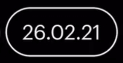
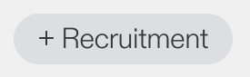
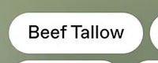
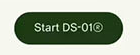
Proof (source / rebuilt / kit): 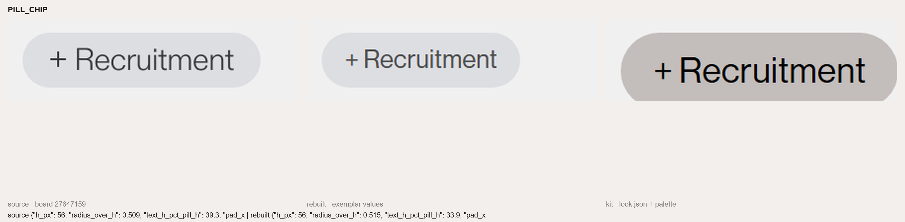
Proof (source / rebuilt / kit): 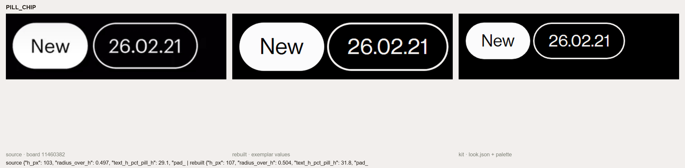

### photo_card

Photo card: an image with small rounded corners set inside a glass card at a fixed inset.

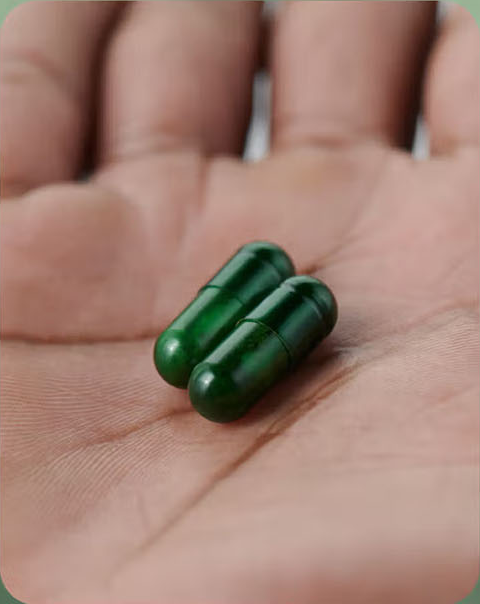
Proof (source / rebuilt / kit): 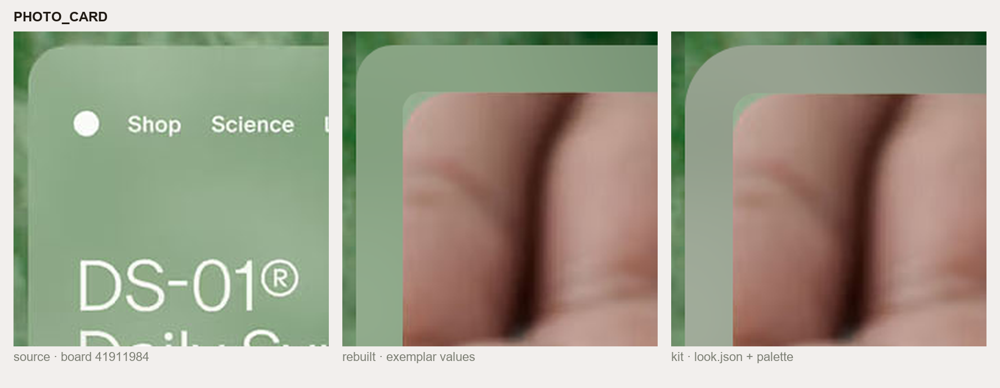
Proof (source / rebuilt / kit): 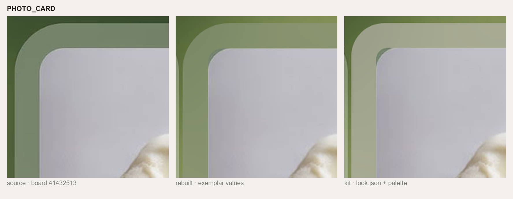

### vertical_type

Vertical type: a caps line rotated 90 degrees along an edge.

Proof (source / rebuilt / kit): 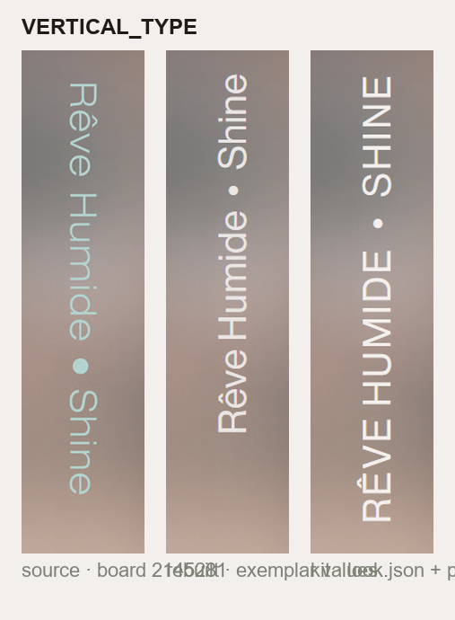

### icon_outline

Icons: white monoline outlines (close, menu, send, play), round ends, no fill.

Proof (source / rebuilt / kit): 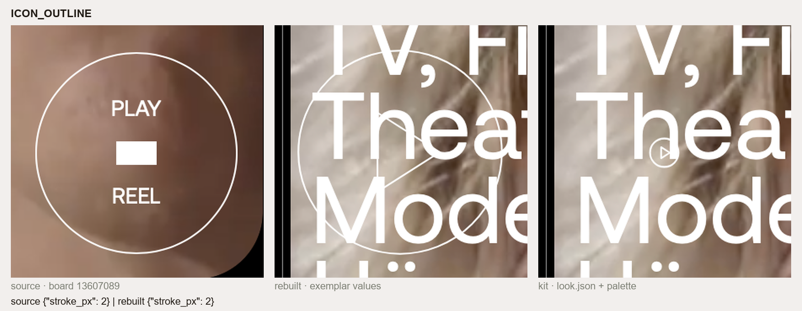

### outline_box

Outline box: a hairline rectangle around a caps title or a product callout.

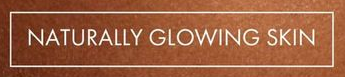
Proof (source / rebuilt / kit): 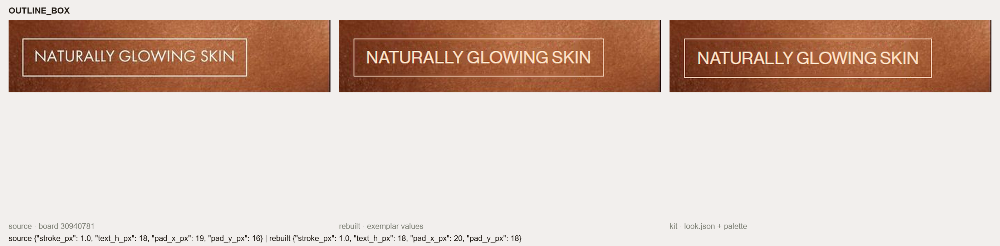

### dotted_path

Dotted path: dotted connector or perforated edge.

Proof (source / rebuilt / kit): 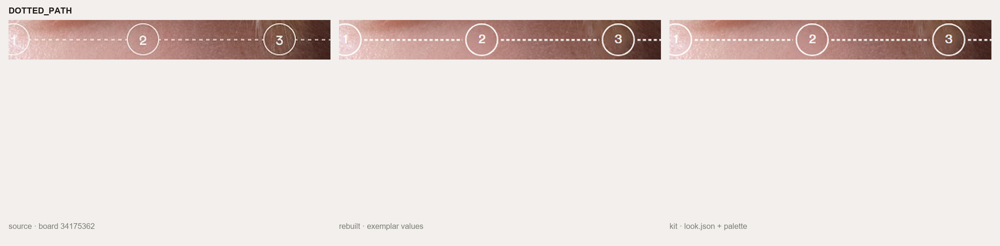

## Dropped

- **ring_button** (3 images): Ring button: a large hairline circle with a centred label (PLAY / REEL), or flat pale circles.
- **glow_line** (1 image): Glow line: a hot light streak with a warm halo across the face.

Proof numbers (each rebuild re-measured with the source's estimator): `look/proof_check.json`.

Measured parameters: `look/measure.json` (script `scripts/look_measure.py`); rebuilt components: `kit/components/`; final numbers: `kit/look.json`.
